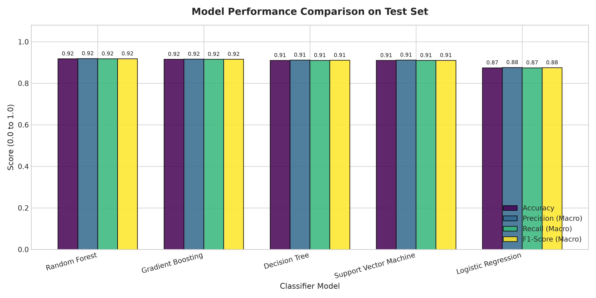
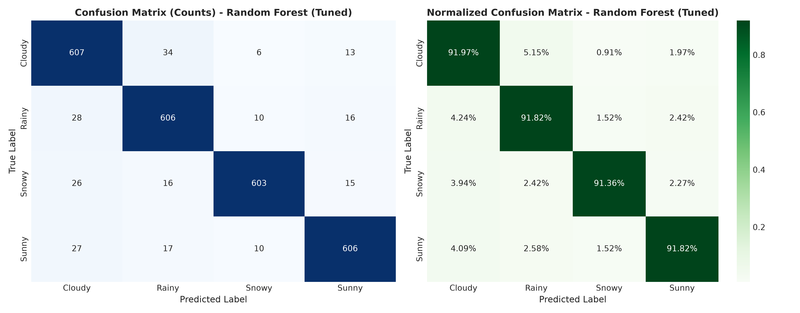
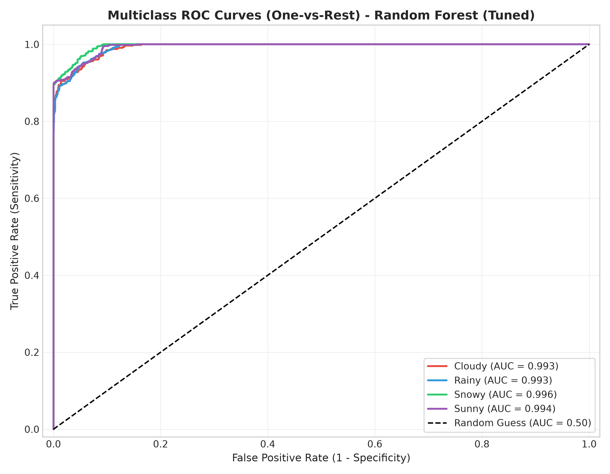
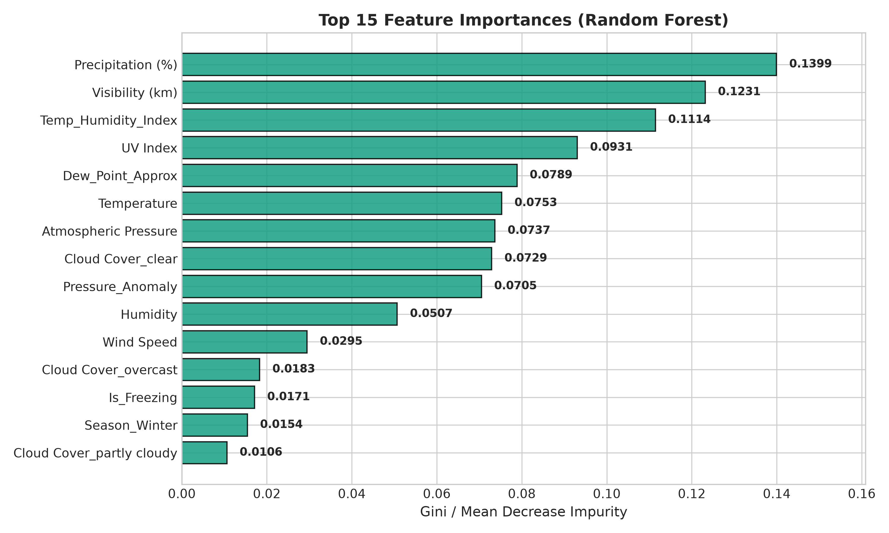
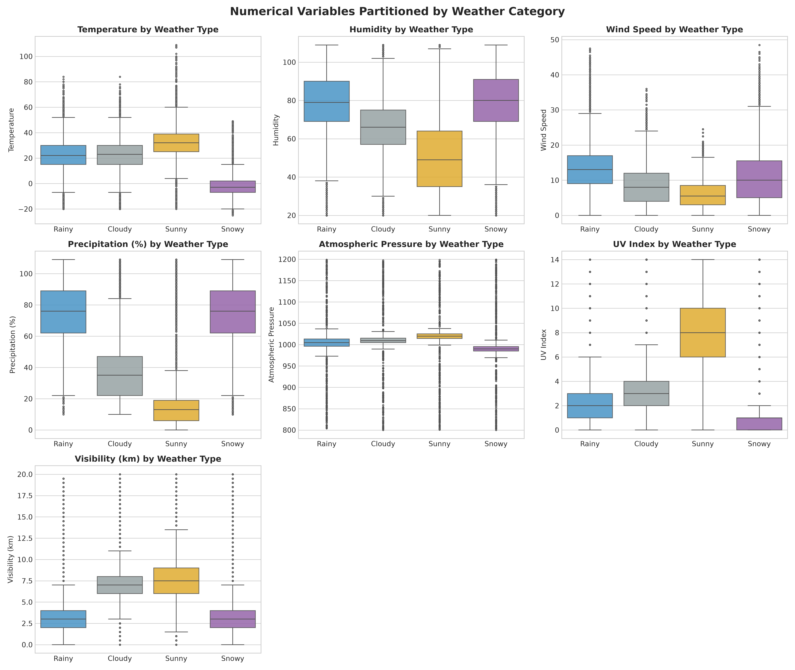
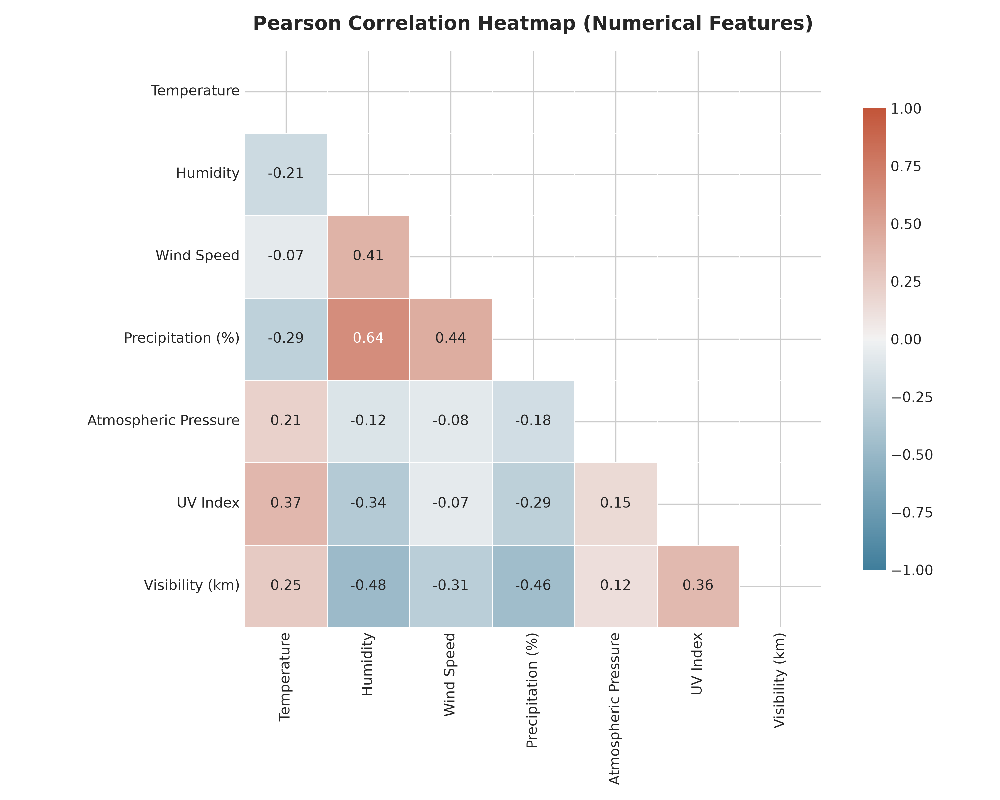

# 🌦️ Weather Type Prediction Using Machine Learning

<p align="center">
  
</p>

<p align="center">
  <a href="#"></a>
  <a href="#"></a>
  <a href="#"></a>
  <a href="#"></a>
  <a href="#"></a>
  <a href="#"></a>
</p>

---

## 📖 Project Overview

Weather conditions directly govern critical sectors of human society—from commercial flight dispatching and highway transit safety to agricultural irrigation and disaster management. 

This project delivers an **end-to-end Machine Learning and Predictive Analytics system** that classifies complex atmospheric patterns across **13,200 observation records** into four balanced meteorological categories:
* ☀️ **Sunny**
* ☁️ **Cloudy**
* 🌧️ **Rainy**
* ❄️ **Snowy**

Beyond pure classification, the system bridges algorithmic intelligence with operational reality through an automated **Decision Support System** that outputs tailored safety alerts for **Aviation**, **Agriculture**, **Logistics**, and **Public Events**.

---

## 🎯 Key Achievements & Findings

* **13,200 Balanced Records Analyzed:** Explored relationships across 11 meteorological variables with zero missing values.
* **Domain Feature Engineering:** Formulated meteorological compound indexes (**Dew Point**, **Temperature-Humidity Index (THI)**, **Barometric Pressure Anomaly**, and **Sub-Zero Freezing Flags**).
* **Statistical Feature Ranking:** Leveraged **Mutual Information** and **ANOVA F-Score** statistics, revealing **Atmospheric Pressure** ($MI=0.651$) and **THI** ($MI=0.634$) as the strongest predictors.
* **Rigorous 5-Model Benchmark:** Evaluated Logistic Regression, Decision Tree, Random Forest, HistGradientBoosting, and Support Vector Machine (SVC) with **5-fold Stratified Cross-Validation**.
* **Champion Model Performance:** Tuned Random Forest achieved **91.78% Test Accuracy**, **91.81% Macro F1-Score**, and **0.9940 Multiclass ROC-AUC (OvR)**.
* **Interactive Web Application:** Built an interactive web dashboard with real-time sliders, dynamic probability bars, and operational risk mitigation guidance.

---

## 🏆 Model Performance & Benchmarks

All models were evaluated on an identical **held-out 20% test set (2,640 records)** following 5-fold Stratified Cross-Validation on the training set:

| Model Architecture | Test Accuracy | Precision (Macro) | Recall (Macro) | F1-Score (Macro) | ROC-AUC (OvR) | 5-Fold CV Accuracy |
| :--- | :---: | :---: | :---: | :---: | :---: | :---: |
| 🥇 **Random Forest (Champion)** | **91.78%** | **0.9189** | **0.9178** | **0.9181** | **0.9940** | **91.43% (±0.0035)** |
| 🥈 **HistGradientBoosting** | 91.55% | 0.9163 | 0.9155 | 0.9157 | 0.9939 | 91.51% (±0.0050) |
| 🥉 **Decision Tree** | 91.02% | 0.9117 | 0.9102 | 0.9105 | 0.9694 | 90.81% (±0.0038) |
| 🔹 **Support Vector Machine (SVC)** | 90.98% | 0.9118 | 0.9098 | 0.9103 | 0.9898 | 91.02% (±0.0036) |
| 🔹 **Logistic Regression** | 87.46% | 0.8760 | 0.8746 | 0.8750 | 0.9638 | 87.79% (±0.0043) |

### 📊 Per-Class Precision & Recall Breakdown (Tuned Random Forest)
```
              precision    recall  f1-score   support
      Cloudy     0.8823    0.9197    0.9006       660
       Rainy     0.9004    0.9182    0.9092       660
       Snowy     0.9587    0.9136    0.9356       660
       Sunny     0.9323    0.9182    0.9252       660
    accuracy                         0.9174      2640
   macro avg     0.9184    0.9174    0.9177      2640
```

---

## 📈 Visual Diagnostic Gallery

### 1. Confusion Matrix (Raw Counts & Normalized Percentages)
<p align="center">
  
</p>

### 2. Multiclass ROC Curves (One-vs-Rest)
<p align="center">
  
</p>

### 3. Top Discriminating Feature Importances
<p align="center">
  
</p>

---

## 🔬 Exploratory Data Analysis Highlights

<p align="center">
  
</p>

* **Temperature Discretization:** Sub-zero temperatures strictly bound Snowy observations (mean $-4.2^\circ\text{C}$), while Sunny days peak above $25^\circ\text{C}$.
* **Atmospheric Pressure Collapse:** Cyclonic storm formations manifest in sharp barometric pressure drops during rainy conditions (mean $995\text{ hPa}$) versus fair-weather highs ($1018\text{ hPa}$).
* **Solar Radiation Filtration:** Sunny days maintain high UV indices ($7\text{--}14$), while overcast cloud cover reduces UV to near-zero levels.

<p align="center">
  
</p>

---

## 💡 Practical Decision Support Guidance

The model's probabilistic predictions feed directly into sector-specific decision engines:

| Sector | Operational Rule / Trigger | Automated Advisory Output |
| :--- | :--- | :--- |
| **✈️ Aviation** | Visibility $< 3\text{ km}$ | **CRITICAL:** Activate Instrument Flight Rules (IFR); low visibility landing protocols. |
| **✈️ Aviation** | Wind Speed $> 30\text{ km/h}$ | **WARNING:** Crosswind landing precautions and wind-shear advisories active. |
| **✈️ Aviation** | Predicted `Snowy` OR $T \le 0^\circ\text{C}$ with precip | **ALERT:** High airframe icing & runway accumulation risk; mandatory de-icing. |
| **🌾 Agriculture** | Predicted `Rainy` OR Precipitation $> 60\%$ | **RECOMMENDED:** Pause automated center-pivot irrigation; preserve groundwater. |
| **🌾 Agriculture** | Temperature $< 0^\circ\text{C}$ | **FROST ADVISORY:** Deploy orchard heaters & crop thermal blankets. |
| **🚚 Logistics** | Predicted `Snowy` / `Rainy` OR Visibility $< 4\text{ km}$ | **ADVISORY:** Wet / icy pavement expected. Enforce 20% speed reductions. |
| **🚚 Logistics** | Wind Speed $> 35\text{ km/h}$ | **WARNING:** High winds pose rollover hazards for high-profile freight trailers. |
| **🎪 Events & Public** | Predicted `Sunny` AND UV Index $\ge 7$ | **HEAT & UV WARNING:** Extreme UV. Mandatory shade canopies & hydration points. |

---

## 📂 Project Architecture

```
Weather prediction/
├── index.html                             # Standalone interactive showcase web page (GitHub Pages ready)
├── project_showcase.html                  # Full project web presentation & live simulator
├── app.py                                 # Flask web application server
├── main.py                                # End-to-end pipeline runner
├── requirements.txt                       # Project dependencies
├── README.md                              # Comprehensive project documentation
├── data/
│   └── weather_classification_data.csv    # 13,200 observation meteorological dataset
├── src/
│   ├── __init__.py
│   ├── eda.py                             # Exploratory Data Analysis & visual generation
│   ├── preprocess.py                      # Preprocessing, domain features & MI scoring
│   ├── train.py                           # Benchmark, tuning, pipeline serialization
│   ├── evaluate.py                        # Metrics, confusion matrix, ROC-AUC curves
│   └── predict.py                         # Production inference & decision support
├── reports/
│   ├── dataset_summary.txt                # Descriptive statistics breakdown
│   ├── model_comparison.csv              # Full model benchmark results table
│   ├── classification_report.txt          # Detailed test set classification metrics
│   └── figures/                           # 9 Publication-quality visual figures
│       ├── 01_class_distribution.png
│       ├── 02_numerical_distributions.png
│       ├── 03_boxplots_by_weather.png
│       ├── 04_correlation_heatmap.png
│       ├── 05_categorical_breakdown.png
│       ├── 06_model_comparison.png
│       ├── 07_confusion_matrix_best_model.png
│       ├── 08_multiclass_roc_best_model.png
│       └── 09_feature_importances.png
├── models/
│   └── weather_classifier_pipeline.joblib # Serialized production inference bundle
├── notebooks/
│   └── Weather_Type_Prediction.ipynb      # Step-by-step interactive Jupyter notebook
└── templates/
    └── index.html                         # Real-time web dashboard template
```

---

## 🚀 Quickstart Guide

### 1. Clone & Install Dependencies
```bash
git clone https://github.com/SasmithaNimesh/Weather-Type-Prediction-ML.git
cd Weather-Type-Prediction-ML
pip install -r requirements.txt
```

### 2. Run the Complete End-to-End ML Pipeline
Executes exploratory analysis, 5-fold cross-validation across all 5 models, hyperparameter tuning, plot generation, and test inference:
```bash
python main.py
```

### 3. Launch the Interactive Web Dashboard
```bash
python app.py
```
Open **[http://localhost:5000](http://localhost:5000)** in your browser for live slider predictions, or **[http://localhost:5000/showcase](http://localhost:5000/showcase)** for the full project interpretation page.

### 4. Run CLI Inference Scenarios
```bash
python -m src.predict
```

---

## 👤 Author
* **R.M. Sasmitha Nimesh**
* GitHub: [@SasmithaNimesh](https://github.com/SasmithaNimesh)
* Email: [rmsasmithanimesh@gmail.com](mailto:rmsasmithanimesh@gmail.com)
